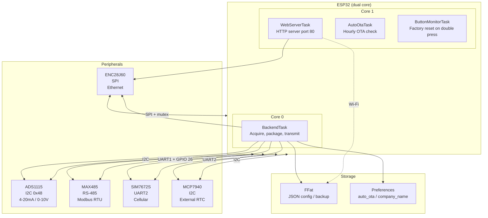

The firmware is built as a single Arduino sketch compiled into one translation unit that includes three headers. It runs four FreeRTOS tasks on the ESP32 dual-core processor, shares configuration and state through global variables, and coordinates access to the Ethernet SPI bus with a single mutex.

## Component diagram

## How the files relate

The project has one `.ino` file and three `.h` files. All headers are `#include`d into the main sketch, so they participate in the same translation unit:

- `lite_V_0_6_ffat__hybrid.ino` defines task functions, setup/loop, web handlers, OTA logic, and page builders.
- `definitions.h` defines pins, structs, and external globals.
- `functions.h` defines helper functions for networking, Modbus, storage, and time.
- `sima7672s.h` defines modem AT command wrappers.

Because there is no separate compilation, every global declared `extern` in the headers and defined in the main sketch is visible everywhere. This means tasks share the same mutable state without isolation.

## Main global config and state objects

| Object | Type | File | Role |
| --- | --- | --- | --- |
| `settings` | `SettingsConfig` | `definitions.h` | Runtime network/protocol config |
| `settings_s` | `SettingsConfig` | `definitions.h` | Shadow copy edited by web UI; applied after reboot |
| `mbConfig` | `ModbusConfig` | `definitions.h` | Runtime analog/IO enable flags |
| `mbConfig_s` | `ModbusConfig` | `definitions.h` | Shadow copy edited by web UI |
| `modbusDevices[]` | `ModbusDevice[32]` | `definitions.h` | Runtime Modbus device table |
| `modbusDevices_s[]` | `ModbusDevice[32]` | `definitions.h` | Shadow copy edited by web UI |
| `modbusDeviceCount` | `int` | `definitions.h` | Number of configured devices |
| `login` | `LoginCredentials` | `definitions.h` | Current web login credentials |
| `servers` | `server_config` | `definitions.h` | NTP and FTP server settings (live, not shadowed) |
| `isAuthenticated` | `bool` | main sketch | Single global auth flag for all clients/interfaces |
| `ethernet_connected` | `bool` | main sketch | Ethernet link state |
| `wifi_connected` | `bool` | main sketch | Wi-Fi STA connection state |
| `sim_available` | `bool` | main sketch | SIM detected flag |
| `internet_` | `bool` | main sketch | Modem "internet OK" flag from `checkInternet()` |
| `ntp_connected` | `bool` | main sketch | Time sync achieved |
| `ota_in_progress` | `bool` | main sketch | OTA lock |
| `backend_idle` | `volatile bool` | main sketch | Backend pause handshake for OTA/config mode |

## FreeRTOS tasks

| Name | Function | Line | Stack | Priority | Core | Responsibility |
| --- | --- | --- | --- | --- | --- | --- |
| WebServerTask | `webServerTask()` | L132 | 10240 | 1 | 1 | Serve HTTP on Wi-Fi (`WebServer`) and Ethernet (`EthernetServer`) port 80. Routes requests, sets `wifiConfigMode`/`ethernetConfigMode`, and updates `lastWebActivity`. |
| BackendTask | `backendTask()` | L380 | 8192 | 1 | 0 | Acquire sensor data, build JSON payload, attempt transmit over GSM → Ethernet → Wi-Fi, handle offline buffering, and manage reboot timers. |
| AutoOtaTask | `startAutoOTAUpdateTask()` | L6439 | 8192 | 1 | 1 | Wait 15 s on boot, then loop hourly. If auto-update enabled and Ethernet/Wi-Fi up, fetch remote version and firmware.bin over HTTP, verify optional MD5, and flash via `Update`. |
| ButtonMonitorTask | `buttonMonitorTask()` | L1212 | 4096 | 1 | 1 | Poll GPIO0 every 10 ms. Two presses within 600 ms formats FFat and restarts (factory reset). |

<Warning>
  The comment on `WebServerTask`'s `xTaskCreatePinnedToCore` call says `Core (0)`, but the actual argument passed is `1` (`lite_V_0_6_ffat__hybrid.ino` L1175). This is a stale comment.
</Warning>

## Shared-resource coordination

### Ethernet SPI mutex

The ENC28J60 SPI bus is protected by `ethernetSpiMutex` (`xSemaphoreCreateMutex()` in `setup()` at L1094). The helper class `EthernetSpiGuard` (`functions.h` L37) takes the mutex in its constructor and gives it in the destructor. It is used around:

- Ethernet SPI control in `webServerTask()` when an Ethernet client is active (`lite_V_0_6_ffat__hybrid.ino` L135)
- `checkEthernet()` and `ethIP()` (`functions.h` L309, L327)
- MQTT connect/publish over Ethernet (`functions.h` L359, L391)
- HTTP POST over Ethernet (`functions.h` L513)
- TCP send over Ethernet (`functions.h` L599)
- Raw FTP operations (`functions.h` L1232, L1256)

### Config-mode pause

When the web UI is accessed, `wifiConfigMode` or `ethernetConfigMode` is set to `true` and `lastWebActivity` is updated (`lite_V_0_6_ffat__hybrid.ino` L122-123, L138-139). In `backendTask()` (L569-575):

- If 30 seconds pass without activity, the flag expires.
- While either flag is `true`, the backend loop delays 100 ms and `continue`s, skipping all acquisition and transmission.
- Payloads that would have been sent during config mode are **discarded**, not buffered (L758).

### OTA pause handshake

When `ota_in_progress` is set to `true` (by `AutoOtaTask` or a manual upload handler), `backendTask()` sees it at the top of its loop (L560), sets `backend_idle = true`, blinks the LED, and yields for 100 ms before continuing. This prevents the backend from performing SPI or network operations while the OTA task or upload handler is active. When OTA finishes or fails, `ota_in_progress` is cleared and normal operation resumes.

### Task watchdog

Only `BackendTask` is registered with the ESP32 task watchdog (`lite_V_0_6_ffat__hybrid.ino` L407-421):

- `esp_task_wdt_deinit()`
- `esp_task_wdt_init()` with `timeout_ms = 65000`, `idle_core_mask = (1 << 0)`, `trigger_panic = true`
- `esp_task_wdt_add(NULL)` for the current task

This means a 65-second watchdog timeout will panic-reboot the device if `BackendTask` stalls. No other task is watched.

### 30-minute no-success restart

If no successful send occurs for 30 minutes, the device restarts (`lite_V_0_6_ffat__hybrid.ino` L1084-1088). The mechanism is indirect: `last_network_fail` is reset only inside `led_blink(..., 1)` (`functions.h` L946-948), which is called after each successful send. If the LED helper is never invoked with `count == 1`, the timer elapses and `ESP.restart()` fires. This is a side effect of an LED utility, not an explicit health timer.

<Warning>
  This restart rule is not evaluated while OTA is in progress or while config mode is active, so a long config session or stalled OTA can delay or prevent the restart.
</Warning>

### Shared mutable state without locks

Beyond the Ethernet SPI mutex, the firmware does not use locks or atomic access for most shared globals. Notable examples include:

- `servers` is edited live by the Wi-Fi web handlers (for example, `/servers` POST writes directly into `servers` and then saves), while `backendTask()` reads it for NTP and FTP settings.
- `settings` and `settings_s` are read and written by both web and backend contexts, but `settings_s` is only copied into `settings` during a save-and-reboot flow.
- `isAuthenticated` is a single global boolean: once any client logs in on any interface, all subsequent requests from all clients on both Wi-Fi and Ethernet are treated as authenticated until `/logout` or reboot.

These patterns can lead to race conditions under concurrent access, especially if the web UI and backend task hit the same mutable struct at the same time.
