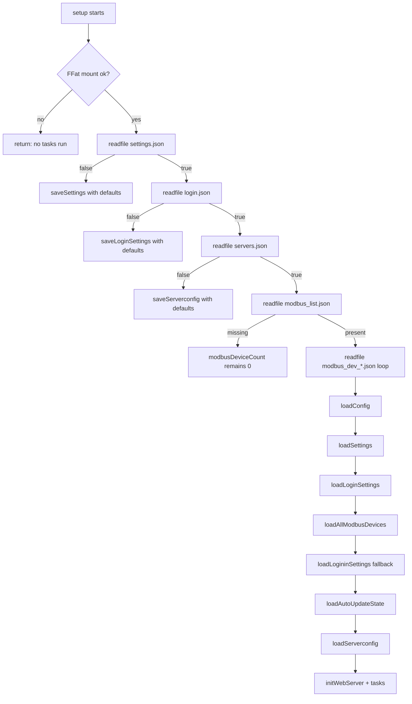

All persistent configuration on the Ethicstech IoT Gateway Lite is stored in two places: FFat JSON files on the flash filesystem and a small number of keys in the ESP32 Preferences library. There is no schema versioning or migration logic. Missing files are recreated with hard-coded defaults at boot, and missing JSON keys fall back to ArduinoJson defaults (0, false, or empty string) unless an explicit `| default` expression is used.

## Struct definitions

These structs are declared in `definitions.h` and consumed by both the web UI and the backend task.

### `ModbusConfig` (L68)

| Field | Type | Default | Consumed by |
| --- | --- | --- | --- |
| `enable_420ma_ch1` | bool | false | Data acquisition, `/io_status`, `/interface` form |
| `enable_420ma_ch2` | bool | false | Data acquisition, `/io_status`, `/interface` form |
| `enable_1_10v_ch1` | bool | false | Data acquisition, `/io_status`, `/interface` form |
| `enable_1_10v_ch2` | bool | false | Data acquisition, `/io_status`, `/interface` form |
| `enable_io_ch1` | bool | false | Data acquisition, `/io_status`, `/interface` form |
| `enable_io_ch2` | bool | false | Data acquisition, `/io_status`, `/interface` form |

### `SettingsConfig` (L81)

| Field | Type | Default | Consumed by | Notes |
| --- | --- | --- | --- | --- |
| `mode` | char[10] | `"AP Only"` | `setupWiFi()` | `"AP Only"`, `"STA Only"`, `"Both"` |
| `std_ssid` | char[32] | `"ethicstech"` | `setupWiFi()` STA | n/a |
| `std_password` | char[64] | hard-coded | `setupWiFi()` STA | Open networks unsupported |
| `ap_user` | char[32] | `"Iotgateway_lite"` | `setupWiFi()` AP | n/a |
| `ap_pass` | char[64] | hard-coded | `setupWiFi()` AP | n/a |
| `apn` | char[16] | `"Airtel"` | GSM APN resolver | **Not editable via web UI** |
| `custom_apn` | char[32] | `"M2MISAFE"` | GSM APN resolver | Used when `apn` is `"Custom"` |
| `eth_mode` | char[10] | `"Dynamic"` | `initEthernet()` | `"Dynamic"` or `"Static"` |
| `eth_ip` | char[16] | `""` | Static Ethernet | n/a |
| `eth_subnet` | char[16] | `""` | Static Ethernet | n/a |
| `eth_gateway` | char[16] | `""` | Static Ethernet | n/a |
| `wifi_mode` | char[10] | `"Dynamic"` | `setupWiFi()` STA | `"Dynamic"` or `"Static"` |
| `wifi_ip` | char[16] | `""` | Static Wi-Fi | n/a |
| `wifi_subnet` | char[16] | `""` | Static Wi-Fi | n/a |
| `wifi_gateway` | char[16] | `""` | Static Wi-Fi | n/a |
| `use_http` | bool | false | Transport selector | n/a |
| `use_tcp` | bool | false | Transport selector | n/a |
| `use_mqtt` | bool | false | Transport selector | n/a |
| `http_scheme` | char[8] | `"http"` | HTTP client | `"http"` or `"https"` |
| `http_url` | char[128] | `""` | HTTP client | Full URL or host path |
| `http_delay` | uint16_t | 1000 | Stored only | **Configured but not used** |
| `http_auth_type` | char[16] | `"None"` | HTTP client | `"None"`, `"Bearer"`, `"APIKey"` |
| `http_token` | char[64] | `""` | HTTP Bearer header | n/a |
| `http_key_value` | char[64] | `""` | HTTP `X-API-Key` header | n/a |
| `http_ca_cert_path` | char[64] | `""` | mTLS / TLS verify | PEM path on FFat |
| `http_client_cert_path` | char[64] | `""` | mTLS client cert | PEM path on FFat |
| `http_private_key_path` | char[64] | `""` | mTLS private key | PEM path on FFat |
| `tcp_ip` | char[16] | `""` | TCP client | n/a |
| `tcp_port` | uint16_t | 6000 | TCP client | n/a |
| `tcp_delay` | uint16_t | 1000 | Stored only | **Configured but not used** |
| `mqtt_broker` | char[64] | `""` | MQTT client | n/a |
| `mqtt_port` | uint16_t | 1883 | MQTT client | n/a |
| `mqtt_uplink` | char[32] | `""` | MQTT publish topic | n/a |
| `mqtt_downlink` | char[32] | `""` | Stored only | **Configured but not used** |
| `mqtt_delay` | uint16_t | 1000 | Stored only | **Configured but not used** |
| `mqtt_auth_type` | char[16] | `"None"` | MQTT connect | `"None"`, `"UserPass"`, `"Token"` |
| `mqtt_username` | char[32] | `""` | MQTT auth | n/a |
| `mqtt_password` | char[64] | `""` | MQTT auth | n/a |
| `mqtt_token` | char[64] | `""` | MQTT Token auth | Used as both username and password |
| `trans_delay` | uint16_t | 30 | Backend loop | Seconds between transmission cycles |

<Info>
  `http_delay`, `tcp_delay`, `mqtt_delay`, and `mqtt_downlink` are stored and editable in the UI, but the backend only uses `trans_delay` for scheduling. `mqtt_downlink` has no subscribe handling implemented.
</Info>

<Info>
  `apn` and `custom_apn` are not set by any web handler. The only way to change the APN is to edit `/settings.json` directly or change the hard-coded default and reflash.
</Info>

### `ModbusDevice` (L145)

| Field | Type | Default | Notes |
| --- | --- | --- | --- |
| `slave_id` | uint8_t | 1 | Modbus slave address |
| `baud_rate` | uint32_t | 9600 | Serial baud for `testSerial` |
| `parity` | char[10] | `"None"` | `"None"`, `"Even"`, `"Odd"` |
| `stop_bits` | uint8_t | 1 | 1 or 2 |
| `reg_type` | char[32] | `"Holding Register"` | `"Coil"`, `"Discrete Input"`, `"Input Register"`, `"Holding Register"` |
| `timeout` | uint16_t | 1000 | ms |
| `num_registers` | int | 0 | Up to `MAX_REGISTERS_PER_DEVICE` (150) |
| `registers[150]` | uint16_t[] | 0 | 1-based addresses stored as entered |

### `LoginCredentials` (L159)

| Field | Type | Default | Notes |
| --- | --- | --- | --- |
| `username` | char[32] | `"admin"` | Always `"admin"` in saved JSON |
| `password` | char[64] | `"admin"` | Stored in plaintext |

### `server_config` (L175)

| Field | Type | Default | Consumed by |
| --- | --- | --- | --- |
| `ntpServerName` | char[64] | hard-coded IP | NTP sync (Wi-Fi and Ethernet) |
| `ntpsynctimeinterval` | uint32_t | 30 | NTP resync interval (minutes) |
| `ftp_server` | char[64] | `""` | FTP upload (all transports) |
| `ftp_port` | uint16_t | 21 | Ethernet / Wi-Fi FTP |
| `ftp_user` | char[32] | `""` | FTP username |
| `ftp_pass` | char[32] | `""` | FTP password |
| `ftp_path` | char[64] | `""` | FTP remote directory |
| `FTP_DELAY` | uint32_t | 30 | Minutes between FTP upload attempts |
| `use_FTP` | bool | false | Enables backup queuing and upload |

## FFat file map

| File | Keys | Load function | Save function | Written by route |
| --- | --- | --- | --- | --- |
| `/settings.json` | All `SettingsConfig` fields | `loadSettings()` L1759 | `saveSettings()` L1848 | Wi-Fi `/network_settings` POST, `/protocols` POST; Ethernet `/network_settings` POST, `/protocols` POST |
| `/login.json` | `login_user`, `login_pass` | `loadLoginSettings()` L1695, `loadLogininSettings()` L1919 | `saveLoginSettings()` L1682, `saveLogininSettings()` L1905 | Wi-Fi `/profile` POST, `/reset` POST; Ethernet `/login` POST (same file) |
| `/servers.json` | All `server_config` fields | `loadServerconfig()` L1655 | `saveServerconfig()` L1632 | Wi-Fi `/servers` POST; Ethernet `/servers` POST |
| `/modbus_gateway.json` | Six `enable_*` flags | `loadConfig()` L1716 | `saveConfig()` L1740 | Wi-Fi `/interface` POST; Ethernet `/interface` POST |
| `/modbus_list.json` | `device_count` | `loadAllModbusDevices()` L1611 | `saveModbusDeviceListCount()` L1596 | Wi-Fi `/save_modbus` POST (new device); Ethernet `/save_modbus` POST |
| `/modbus_dev_<i>.json` | `slave_id`, `baud_rate`, `parity`, `stop_bits`, `timeout`, `reg_type`, `num_registers`, `reg_0..reg_{n-1}` | `loadModbusDevice()` L1551 | `saveModbusDevice()` L1523 | Wi-Fi `/save_modbus` POST; Ethernet `/save_modbus` POST |
| `/backup_file.json` | Array of JSON objects (offline queue) | `hasStoredData()` | `appendJsonObject()` | Backend task on send failure (see [Storage and FTP](/storage-and-ftp)) |
| `/manual.pdf` | Raw PDF bytes | Streamed directly | Not written by firmware | Must be placed on FFat by other means |
| `/latestdata.json` | n/a | n/a | Never written | Referenced by `/latestdata.json` route but returns 500 |

## Preferences keys

The ESP32 `Preferences` library uses namespace `"settings"`.

| Key | Type | Default | Written by | Consumed by |
| --- | --- | --- | --- | --- |
| `auto_ota` | bool | false | `/set_auto_ota` GET | `startAutoOTAUpdateTask()` |
| `company_name` | string | `""` | `/set_auto_ota` GET | `getDeviceFolderName()` (MQTT client ID, FTP filename, OTA folder) |

Preferences survive a factory reset (button double-press formats FFat but does not touch Preferences).

## Boot load and default creation flow

`readfile()` (L1500) only reads and prints a file to Serial; it returns `false` if the file is missing or unparsable. When a file is missing, the matching `save*()` function writes hard-coded defaults immediately. `loadConfig()` has a subtle path: if `/modbus_gateway.json` is missing, it calls `saveConfig()` but then tries to deserialize the now-invalid file handle and returns early, leaving defaults applied via `| true` fallbacks.

## Shadow-copy model and reboot requirements

The firmware maintains two copies of several structs:

| Runtime struct | Shadow struct | When copied | Reboot required? |
| --- | --- | --- | --- |
| `settings` | `settings_s` | `settings_s = settings` after `loadSettings()` | Yes: web handlers edit `settings_s`; runtime reads `settings` |
| `mbConfig` | `mbConfig_s` | `mbConfig_s = mbConfig` after `loadConfig()` | Yes: web handlers edit `mbConfig_s`; runtime reads `mbConfig` |
| `modbusDevices[]` | `modbusDevices_s[]` | Element-wise during `loadModbusDevice()` | Yes: web handlers edit `modbusDevices_s`; runtime reads `modbusDevices[]` |
| `servers` | none | Edited live | **No**: NTP/FTP changes take effect immediately |
| `login` | none | Edited live | **No**: credential changes take effect immediately |

Because `settings_s`, `mbConfig_s`, and `modbusDevices_s` are only persisted to FFat by the web handlers and only copied back to runtime structs during boot load, you must reboot after changing network, protocol, interface, or Modbus settings. The confirmation pages all present a **Reboot Now** button for this reason.

## Validation, migration, and recovery gaps

The following behaviors are consequences of the current implementation, not design choices:

- **No schema version.** There is no `version` key in any JSON file. Adding new fields later may leave older files partially populated with zeros.
- **No input validation.** IP addresses, port numbers, `trans_delay`, and `num_registers` are not validated server-side. Ethernet protocol numeric fields default to `0` when a form field is missing.
- **No bounds checking on `num_registers`.** `loadModbusDevice()` reads up to 150 registers but does not clamp `num_registers` to `MAX_REGISTERS_PER_DEVICE`.
- **Missing terminator risk.** Several Wi-Fi handlers use `strncpy(..., sizeof(...))` without forcing a null terminator when the input fills the buffer exactly. Ethernet handlers also use `strncpy` without explicit termination in some paths.
- **No recovery from FFat corruption.** If `settings.json` exists but is malformed, `loadSettings()` prints an error and returns without falling back to defaults, leaving `settings` populated with partial or zeroed data.
- **No upload route for PEM files.** Certificate paths (`http_ca_cert_path`, `http_client_cert_path`, `http_private_key_path`) can be configured in the UI, but there is no endpoint to upload the actual PEM files to FFat. They must be placed by other means.
