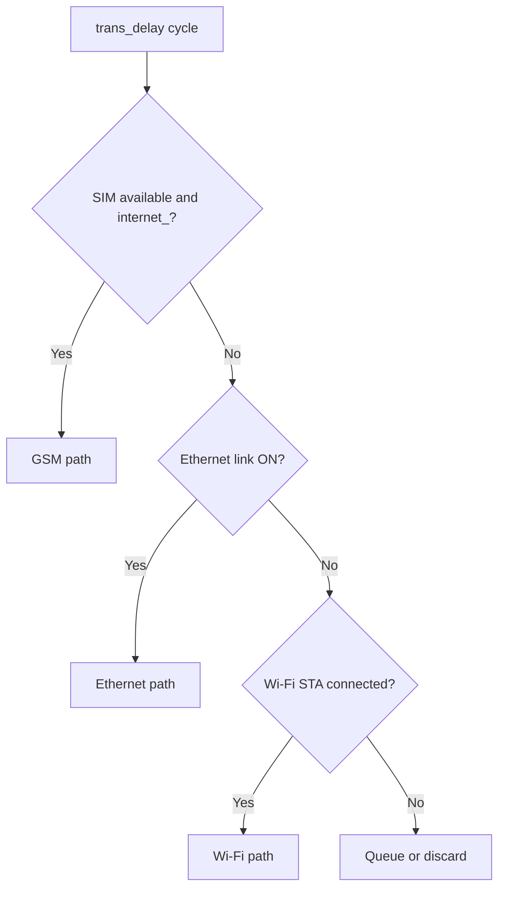
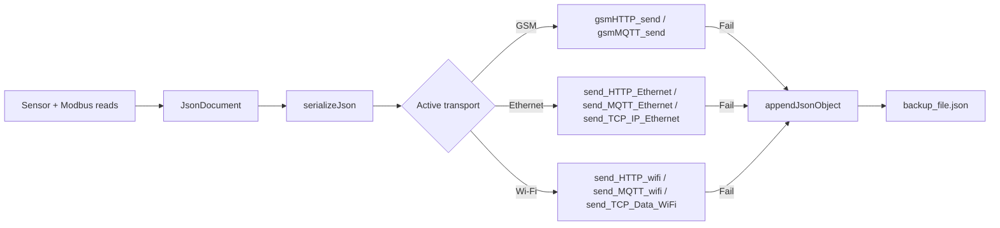

This page covers how the Ethicstech IoT Gateway Lite initializes each network interface, selects a transport, and attempts HTTP, MQTT, and TCP uploads. It also describes offline buffering, the 30-minute restart rule, and known issues. All line references are from `functions.h` and `sima7672s.h` unless noted.

## Interface initialization

### Ethernet (ENC28J60)

`initEthernet()` (`functions.h` L178-305) drives the ENC28J60 through SPI on SCK 14, MISO 12, MOSI 13, and CS 32. The MAC is derived from the ESP32 Wi-Fi MAC string with the first character forced to `'1'` (`parseMacAddress`, L162-176).

- **Dynamic**: calls `Ethernet.begin(mac)`. Link must report `LinkON` to succeed.
- **Static**: requires three consecutive `LinkON` readings within 15 s before returning true. DNS defaults to the gateway if non-zero, otherwise 8.8.8.8.

`checkEthernet()` (`functions.h` L307-325) evaluates link status under `ethernetSpiMutex` and returns a cached state to reduce SPI churn.

<Info>
  Ethernet is initialized in `backendTask` **only when GSM internet is not up** (`backendTask` L464-470). If the modem connects first, the Ethernet web UI and transport path are unavailable for that session.
</Info>

### Wi-Fi

`setupWiFi()` (`functions.h` L93-160) supports three modes from `settings.mode`:

| Mode | Behavior |
| --- | --- |
| `AP Only` | Starts SoftAP; no STA connection attempt |
| `STA Only` | Connects to configured SSID; no AP |
| `Both` | AP + STA simultaneously |

- AP needs both SSID and password non-empty.
- STA needs both SSID and password non-empty (open networks are unsupported).
- Static STA uses hard-coded DNS 8.8.8.8 and 8.8.4.4.
- Connect timeout is 6 s; background reconnect continues afterward.
- `WiFi.setSleep(false)` is applied unconditionally.

In AP-only mode, the device has no internet uplink by default, so payloads are queued (if FTP is enabled) and the 30-minute restart rule may eventually trigger.

### Cellular (SIMA7672S)

`initGSM()` (`sima7672s.h` L33-48) starts UART2 (TX 17, RX 16) at 115200, asserts the power pin, restarts the modem, and waits ~12 s. `connectGSM()` (`sima7672s.h` L294-317) sends an AT sequence:

```text
AT+CFUN=1
AT+CREG=1
AT+CGREG=1
AT+CGDCONT=1,"IP","<apn>"
AT+CGATT=1
AT+CGACT=1,1
```

APN selection is hard-coded by name:

| Setting value | APN used |
| --- | --- |
| Jio | jionet |
| Airtel | airtelgprs.com |
| Vodafone | www |
| BSNL | bsnlnet |
| Custom | `custom_apn` field (default "M2MISAFE") |
| (any other) | www |

<Warning>
  The web UI does **not** include a handler that writes `settings_s.apn` or `settings_s.custom_apn`. Changing the APN requires editing `/settings.json` on FFat by other means. This is not configurable via the UI.
</Warning>

`checkInternet("google.com")` (`sima7672s.h` L584-600) initializes modem HTTP and sets the URL. It returns true on `OK` from the modem, but this does **not** prove end-to-end reachability.

### SIM detection and switching

`simCheck()` (`sima7672s.h` L229-292) probes the selected SIM for `+CPIN: READY`. Because `sim_switch` is `false` at build time, dual-SIM probing at boot is skipped and `dual_sim_available` stays false.

If `dual_sim_available` were true, `monitorSimAndSwitch()` runs every 30 s and switches SIMs when:

- Signal is poor (RSSI less than or equal to 15) continuously for 5 minutes, or
- No GSM send has succeeded for 10 minutes.

A 30-minute debounce prevents rapid toggling. The alternate SIM is kept only if its signal is better or usable (`sima7672s.h` L114-226).

## Transport selection order



The order is strict: GSM first, Ethernet second, Wi-Fi STA third. There is no load-balancing or simultaneous multi-interface send.



## Protocol support matrix

| Protocol | GSM | Ethernet | Wi-Fi | Notes |
| --- | --- | --- | --- | --- |
| HTTP | Yes | Yes (plain only) | Yes (http/https) | GSM uses SSL if `https` |
| MQTT | Yes | Yes | Yes | Client IDs differ per transport |
| TCP | **No** | Yes | Yes | Logged as unsupported on GSM |
| FTP/FTPS | FTPS | FTP | FTP | Queue upload only; see [Storage and FTP](/storage-and-ftp) |

If no protocol is enabled, the payload is still appended to the queue (if FTP is enabled) or silently discarded.

<Warning>
  Per-protocol delays `http_delay`, `tcp_delay`, and `mqtt_delay` are stored and editable in the UI, but they are **not** used by the scheduling logic. Only `trans_delay` controls the cycle interval.
</Warning>

### HTTP

**GSM**

- `gsmHTTP_send()` (`sima7672s.h` L509-582) constructs the full URL from `settings.http_url` and `settings.http_scheme` if no scheme is present. SSL is enabled when the scheme is `https`. Success requires HTTP 200, 201, or 204 in the modem response.
- Two attempts are made on failure; after that the payload is queued.

**Ethernet**

- `send_HTTP_Ethernet()` (`functions.h` L512-596) parses `host:port/path` with `parseURL` and connects by IP when possible to bypass UIPEthernet's slow DNS. Only plain HTTP is supported; `https` is rejected immediately.
- Three connect attempts, 3 s response timeout. No auth headers are applied in the current Ethernet path (not confirmed from source).

**Wi-Fi**

- `send_HTTP_wifi()` (`functions.h` L691-730) uses `HTTPClient`.
- For `https`, `prepareMtlsClient()` loads PEM files from FFat. If no certificates are present, `setInsecure()` is used (no server verification).
- `applyHttpAuthHeaders()` adds `Authorization: Bearer <token>` or `X-API-Key: <key>` when configured.
- Success is HTTP 200 only.

<Warning>
  `prepareMtlsClient()` loads the CA certificate from `http_client_cert_path` instead of `http_ca_cert_path` (`functions.h` L493). This prevents proper CA validation when only the CA path is populated.
</Warning>

### MQTT

**GSM**

- `connectMQTT()` / `gsmMQTT_send()` (`sima7672s.h` L319-506) use `AT+CMQTT*` commands with a 60-second keepalive and QoS 1.
- If the client is not connected, it reconnects before publish. One retry is attempted on publish failure.
- Client ID is `getDeviceFolderName()` (company name from Preferences, or MAC without colons).
- `mqtt_downlink` is stored and passed to `connectMQTT()`, but no downlink handling of substance is implemented.

**Ethernet**

- `connect_MQTT_Ethernet()` / `send_MQTT_Ethernet()` (`functions.h` L351-408) use `PubSubClient` over `EthernetClient`. Socket timeout is 15 s. The publish is non-retained. After publish, `mqttClient.loop()` runs for ~500 ms to flush.
- Client ID is the MAC address with colons.

**Wi-Fi**

- `reconnect_mqtt_wifi()` / `send_MQTT_wifi()` (`functions.h` L642-689) use `PubSubClient` over `WiFiClient`. Buffer size is set to 65534. The client disconnects after each publish.
- Client ID is `getDeviceFolderName()`.

### TCP

**Ethernet**

- `send_TCP_IP_Ethernet()` (`functions.h` L598-640) opens a socket, writes the payload with `client.println(data)`, flushes, and closes. No response is read.

**Wi-Fi**

- `send_TCP_Data_WiFi()` (`functions.h` L732-745) connects, writes raw bytes, and closes. No response is read.

**GSM**

- TCP is not supported. The backend logs `"GSM Does not support TCP/IP"` and does not queue the payload for TCP specifically (`backendTask` L851-855).

## Failure behavior and queuing

When an enabled protocol fails, `backendTask` calls `appendJsonObject()` (`functions.h` L951-988) to write the JSON string to `/backup_file.json`.

- Offline buffering **only happens when `servers.use_FTP` is true**. If FTP is disabled, `appendJsonObject()` returns immediately and the data is lost.
- The first write creates the file starting with `[` + payload. Later writes append `,` + payload.
- A duplicate check skips the write if the payload is identical to the previous one (static in-memory comparison only).
- There is no size cap and no free-space check.

`finalizeJsonArray()` appends `]` before every FTP upload attempt (`functions.h` L1164). If an upload fails, later appends produce malformed JSON because additional objects are written after the closing bracket. Repeated failed attempts add more `]` characters.

### FTP schedule and fallback

When stored data exists and `use_FTP` is enabled (plus `ntp_connected` for Ethernet/Wi-Fi paths), a timer starts. After `FTP_DELAY` minutes, the upload is attempted:

- **GSM**: `gsm_FTP()` → on fail, fallback to Ethernet `sendFTPEthernet()` → on fail, fallback to Wi-Fi `uploadToFTP_Wifi()`.
- **Ethernet**: `sendFTPEthernet()` → on fail, fallback to Wi-Fi `uploadToFTP_Wifi()`.
- **Wi-Fi**: `uploadToFTP_Wifi()`.

If upload fails, the timer restarts and retries after another `FTP_DELAY` interval. On success, `/backup_file.json` is deleted. See [Storage and FTP](/storage-and-ftp) for file layout and queue format details.

## 30-minute restart rule

After each transport cycle, if `millis() - last_network_fail >= 30` minutes, the device reboots (`backendTask` L1084-1088). `last_network_fail` is reset inside `led_blink(x, 1)` (`functions.h` L946-948), which is called after every successful send. Therefore, the device restarts whenever no protocol successfully sends for 30 minutes, including when the device is in AP-only mode or no protocol is enabled. This rule is not evaluated during OTA or config mode.

## Known issues

1. **Per-protocol delays unused**: `http_delay`, `tcp_delay`, and `mqtt_delay` are stored but never applied.
2. **MQTT downlink unused**: `mqtt_downlink` is stored and subscribed during GSM connect, but no downlink handling of substance is implemented.
3. **CA path bug**: `prepareMtlsClient()` loads the CA from `http_client_cert_path` instead of `http_ca_cert_path`.
4. **Ethernet HTTP has no TLS**: Only plain HTTP is supported; `https` requests are rejected.
5. **checkInternet caveat**: The GSM internet check only validates modem HTTP setup, not actual end-to-end reachability.
6. **No GSM TCP support**: TCP is only available over Ethernet and Wi-Fi.
7. **Queue corruption on failed FTP**: `finalizeJsonArray()` may produce invalid JSON after failed uploads.
8. **Wi-Fi FTP port captured at construction**: `ESP32_FTPClient ftp(...)` is constructed with `servers.ftp_port` at global initialization time in `functions.h` L27. Because config is loaded later, a non-default port may not take effect on Wi-Fi (Inferred).
9. **GSM FTPS hard-codes port 21**: The `gsm_FTP()` command uses port 21 regardless of `servers.ftp_port`.

## Related pages

- [Runtime flow](/runtime-flow) for `backendTask` loop timing and transport priority
- [Data acquisition](/data-acquisition) for how the JSON payload is built
- [Storage and FTP](/storage-and-ftp) for offline queue format and FTP implementation
- [Time and RTC](/time-and-rtc) for NTP and timestamp behavior
- [OTA and reset](/ota-and-reset) for OTA pause and restart behavior
- [Configuration](/configuration) for enabling protocols and setting endpoints
