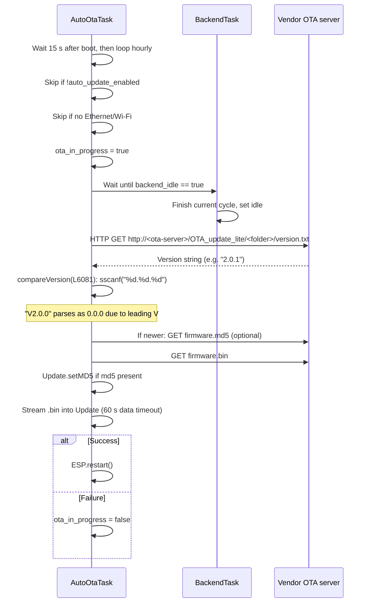

This page covers every way the gateway firmware can be updated, restarted, or returned to factory defaults. References are to `lite_V_0_6_ffat__hybrid.ino` (`main`), `functions.h` (`fn`), and `sima7672s.h` (`sima`).

<Warning>
  OTA transfers are over plain HTTP by default, and firmware integrity is verified with MD5 only. There is no signature-based authentication, no server certificate verification is enforced automatically, and no HTTPS for Ethernet OTA. Treat the device as running unverified firmware until you inspect the source.
</Warning>

## Manual Wi-Fi OTA

The web UI route `/ota` serves an upload form when you are authenticated on Wi-Fi. The actual upload is handled by `POST /update` in `handleOTAUpdate` (`main` L6975).

<Steps>
  <Step title="Browse to /ota">
    Log in, then open `http://<device-ip>/ota`.
  </Step>
  <Step title="Choose a .bin file">
    The form accepts a multipart field named `update`.
  </Step>
  <Step title="Upload">
    The handler first waits until `backend_idle` is true (to avoid concurrent SPI/Serial use), then streams the body into the ESP32 `Update` class.
  </Step>
  <Step title="Result">
    Success: "Update Successful. Rebooting..." followed by `ESP.restart()`. Failure: "Update Failed"; `ota_in_progress` is cleared.
  </Step>
</Steps>

The Wi-Fi upload endpoint is **not authenticated** (`handleOTAUpdate` L6975). Anyone on the Wi-Fi network or AP can trigger an update. This is a known risk; see [limitations](/limitations).

## Manual Ethernet OTA

If Ethernet is initialized at boot, `/ota` renders `buildOTAPageForEthernet` (`main` L6909) and the upload goes to `POST /update_eth` (`handleEthernetOTAUpload` L6924).

- The client must send the whole firmware as raw `application/octet-stream` with a `Content-Length` header.
- The server reads the body in 1 KB chunks and writes them to `Update`.
- If `Content-Length` is missing the upload is rejected with `400 OTA upload rejected`.

Ethernet OTA requires prior Ethernet authentication through the same global `isAuthenticated` flag.

## Automatic OTA

A background task (`AutoOtaTask`, `startAutoOTAUpdateTask` L6439) checks for updates once every hour.

<Info>
  Automatic OTA only runs when `auto_update_enabled` is true **and** the device has an Ethernet or Wi-Fi connection. GSM is not used for auto OTA.
</Info>

### Sequence diagram

### Version check and the V-prefix issue

`compareVersion` (`main` L6081) uses `sscanf(line, "%d.%d.%d", ...)` to parse the remote version. If the remote file contains a version with a leading `V` (for example, `"V2.0.0"`), `sscanf` fails to match any numeric fields and returns `0.0.0`. If the remote version is plain numeric (`"2.0.0"`), it is parsed correctly. This means:

- A `"V"`-prefixed local version will always compare as older than a numeric remote version, so the device may re-flash every hour.
- A `"V"`-prefixed remote version will never trigger an update because it is read as `0.0.0`.

This behavior is **Inferred** from `sscanf` semantics and **requires bench verification**.

### Download source

The firmware binary is fetched from a hard-coded vendor OTA server path: `http://<ota-server>/IoTGatewayLite/OTA_update_lite/<folder>/firmware.bin`. The company name stored in Preferences (or the device MAC without colons) determines `<folder>` through `getDeviceFolderName()` (`main` L6433). There is no TLS option for this download.

### MD5 integrity only

If `firmware.md5` exists on the server, the client sets `Update.setMD5()` before writing the binary. MD5 detects download corruption but does **not** verify authenticity or sign the firmware.

### Backend coordination

The auto-OTA task sets `ota_in_progress = true` before accessing the network. `BackendTask` checks this flag each cycle (`main` L560): when true, it sets `backend_idle = true`, blinks the LED, and short-sleeps. The OTA task waits until `backend_idle` is true before starting the update. The main transport stack is paused during the download.

### Failure handling

If the download or write fails, `ota_in_progress` is cleared so the backend resumes. There is no retry or backoff within the same hour; the next attempt happens on the next hourly loop.

## Auto-OTA toggle route

`GET /set_auto_ota?enable=1|0&company=<name>` toggles the auto-update flag and stores the company name in the `Preferences` namespace (`loadAutoUpdateState` L1943). This route is **publicly accessible on Wi-Fi** (the handler is not behind the auth gate). Changing `company_name` changes:

- MQTT client ID on GSM and Wi-Fi
- FTP filename prefix
- OTA folder path

## Reboot paths

### Web UI reboot

- `/reboot` renders a confirmation page (`buildRebootPage` L7145).
- `GET /reboot?now=1` or `POST /reboot` immediately calls `ESP.restart()` (`handleRebootGet` L7229, `handleRebootPost` L7238).
- Ethernet reboot (`handleEthernetReboot` L7246) is available when Ethernet is active.

### Watchdog reboot

`BackendTask` initializes the ESP-IDF task watchdog with a 65-second timeout and panic-on-expire (`main` L407-421). If the backend task blocks for longer than 65 s, the system reboots. Only the backend task is watched; no other task has watchdog protection.

### 30-minute no-success reboot

If no successful protocol send occurs for 30 minutes, `last_network_fail` causes `ESP.restart()` (`main` L1084-1088). `last_network_fail` is reset inside `led_blink(x, 1)` (`fn` L946-948), which is called after every successful send. This means the restart policy is coupled to an LED helper side effect.

## Factory reset

### Web factory reset

`/factory_reset` shows a confirmation page (`buildFactoryResetPage` L5204). A POST request formats the entire FFat partition and restarts (`handlefactoryreset` L5182, `handlefresetpost` L5175, `handlef_resetGet` L5290). Ethernet has its own handler (`handleEthernetFactoryReset` L7251). All JSON configuration files are erased; the device re-creates defaults on the next boot.

### BOOT button double-click reset

`buttonMonitorTask` (`main` L1212) polls `GPIO 0` every 10 ms. Two presses within 600 ms triggers a full FFat format and restart. The action blinks the LED, waits one second, then reboots.

<Note>
  BOOT-button reset does **not** clear `Preferences`. Values such as `auto_ota` and `company_name` survive and persist across the reset.
</Note>

## Password reset via PIN

`/reset` is a public route on Wi-Fi (`handleResetGet` L2684, `handleResetPost` L2798). It accepts a `pin` field and a `new_pass` field. The PIN value is `RESET_PIN` in `definitions.h`. If the PIN matches, the login password is overwritten with `new_pass`. Because the pin is a compile-time constant and the route is public, anyone who knows or can guess the pin can change the password.
