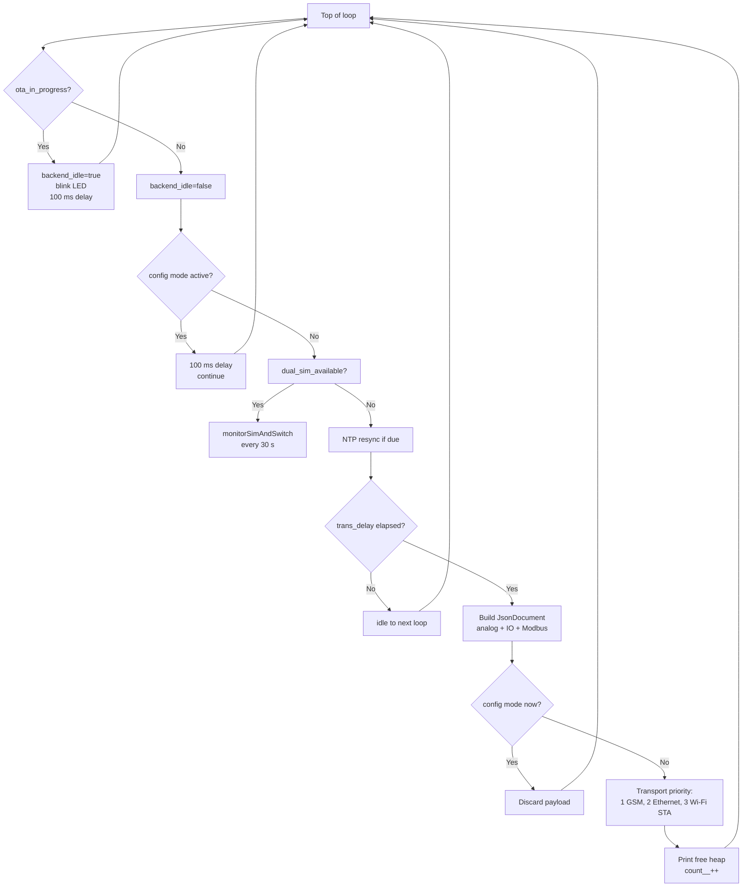

This page traces the firmware's startup sequence in `setup()` and the runtime behavior of the three FreeRTOS tasks: `backendTask`, `webServerTask`, and `buttonMonitorTask`. Sources are the main sketch (`lite_V_0_6_ffat__hybrid.ino`) and `functions.h`.

## Boot sequence

```mermaid
sequenceDiagram
    participant MCU as ESP32
    participant Fat as FFat
    participant Web as Web UI
    participant GSM as SIM Modem
    participant ETH as ENC28J60

    MCU->>Fat: begin(true) mount / format
    alt mount fails
        MCU-->>MCU: return; no tasks start
    else mount succeeds
        MCU->>Fat: create default JSONs if missing
        MCU->>MCU: load config into RAM
        MCU->>MCU: setupWiFi + initWebServer
        MCU->>Web: xTaskCreatePinnedToCore WebServerTask (core 1)
        MCU->>MCU: xTaskCreatePinnedToCore BackendTask (core 0)
        MCU->>MCU: xTaskCreatePinnedToCore AutoOtaTask (core 1)
        MCU->>MCU: xTaskCreatePinnedToCore ButtonMonitorTask (core 1)
    end
    BackendTask->>GSM: initGSM / connectGSM
    BackendTask->>MCU: initRTC / WDT config
    alt SIM internet up
        BackendTask-->>ETH: Ethernet init SKIPPED
    else no SIM internet
        BackendTask->>ETH: initEthernet
    end
```

<Steps>
  <Step title="Serial and mutex">
    `Serial.begin(115200)` starts debug output. `ethernetSpiMutex` is created to protect ENC28J60 SPI access between tasks (`setup()` L1092-1094).
  </Step>
  <Step title="Pin initialization">
    Digital inputs IO1 (GPIO 19) and IO2 (GPIO 4) are set to `INPUT_PULLDOWN`. SS (GPIO 2), LED (GPIO 33), and BOOT (GPIO 0, `INPUT_PULLUP`) are configured. RS-485 DE/RE (GPIO 26) are driven LOW for receive mode with a 20 ms settle delay (`setup()` L1095-1105).
  </Step>
  <Step title="FFat mount">
    `FFat.begin(true)` mounts the FAT filesystem and formats on failure. If mounting still fails, `setup()` returns immediately: no tasks are created and the web UI never starts (`setup()` L1111-1114).
  </Step>
  <Step title="Default file creation">
    If `settings.json`, `login.json`, or `servers.json` are missing, default files are created via `saveSettings()`, `saveLoginSettings()`, and `saveServerconfig()` (`setup()` L1116-1124). Modbus device files are only read (not auto-created) because `modbusDeviceCount` is still zero at this point.
  </Step>
  <Step title="Load configuration">
    `loadConfig()`, `loadSettings()`, `loadLoginSettings()`, `loadAllModbusDevices()`, `loadLogininSettings()`, `loadAutoUpdateState()`, and `loadServerconfig()` populate runtime structs (`setup()` L1138-1144).
  </Step>
  <Step title="Peripherals and Wi-Fi">
    `initADS1115()` (if `ads1115` is defined) starts I2C and configures the ADC. Wi-Fi is set to `WIFI_STA`, the MAC is recorded, and `setupWiFi()` brings up AP and/or STA according to `settings.mode` (`setup()` L1148-1158).
  </Step>
  <Step title="Web server start">
    `initWebServer()` registers all HTTP handlers. `server.begin()` starts the Wi-Fi web server on port 80 (`setup()` L1163-1164).
  </Step>
  <Step title="Task creation">
    Four pinned tasks are created (`setup()` L1168-1203):

    | Task | Stack | Priority | Core | Notes |
    | --- | --- | --- | --- | --- |
    | `webServerTask` | 10240 | 1 | 1 | Comment says "Core (0)"; actual arg is 1 |
    | `backendTask` | 8192 | 1 | 0 | Main data loop and connectivity |
    | `AutoOtaTask` | 8192 | 1 | 1 | Hourly OTA checks |
    | `buttonMonitorTask` | 4096 | 1 | 1 | Factory-reset button monitor |
  </Step>
</Steps>

## backendTask

`backendTask` (`lite_V_0_6_ffat__hybrid.ino` L380-1090) runs on core 0 and handles modem initialization, time sync, sensor/Modbus collection, data transmission, and offline buffering.

### Startup phase (L380-516)

1. **GSM reset and SIM select** `reset_ethernet();` resets the ENC28J60. `selectSIM(SIM1)` sets GPIO 2 HIGH because `sim_switch` is `false` at build time (L385-392).
2. **Modem power-on** `initGSM()` starts UART2 at 115200, asserts the power pin, restarts the modem, and waits ~12 s (`sima7672s.h` L33-48).
3. **RTC** `initRTC()` / `startRTC()` / `rtcBattery()` probe the MCP7940. If all succeed, `external_rtc_connected` becomes true (`backendTask` L397-404).
4. **Task watchdog** The TWDT is reinitialized with a 65 s timeout and panic enabled, then the current task is added (`backendTask` L407-424).
5. **SIM detection** `simCheck()` probes the selected SIM for `+CPIN: READY`. If `sim_switch` were true it would also probe the second SIM; because it is false, `dual_sim_available` stays false at boot (`backendTask` L441; `sima7672s.h` L229-292).
6. **GSM connect** If a SIM is present, `connectGSM()` is attempted up to two times until `checkInternet("google.com")` returns true (`backendTask` L444-459).
7. **Conditional Ethernet init** Ethernet is initialized only when GSM internet is not up (`!ethernet_connected && !internet_`, L464-470). If it succeeds, `ethServer.begin()` starts the Ethernet web server and the first transmit is delayed by one `trans_delay` interval.
8. **Initial time sync** Priority: GSM HTTP time (`getTimeFromHTTP`) → Ethernet NTP (`getNTPDateTime`) → Wi-Fi NTP (`syncNTPWifi`). The first source to succeed sets both the MCP7940 and the internal ESP32Time (`backendTask` L483-515).

### Main loop (L557-1089)



#### OTA pause

When `ota_in_progress` is true (set by the auto/manual OTA paths), the backend sets `backend_idle = true`, blinks the LED twice, delays 100 ms, and skips all other work (`backendTask` L560-565). This prevents SPI and network contention during firmware writes.

#### Config-mode pause

Web activity sets `wifiConfigMode` or `ethernetConfigMode` and records `lastWebActivity`. If either mode flag is set, the backend delays 100 ms and restarts the loop, so the web UI has full CPU and radio bandwidth (`backendTask` L569-581). The mode expires 30 s after the last request.

<Warning>
  If a config-mode session is active when a `trans_delay` cycle fires, the assembled payload is discarded and is not buffered (`backendTask` L758-762). Data is lost for that cycle.
</Warning>

#### SIM monitoring

If `dual_sim_available` is true, `monitorSimAndSwitch()` runs every 30 s. It switches SIMs when signal is poor for 5 minutes or no GSM send has succeeded for 10 minutes, with a 30-minute debounce between switches (`sima7672s.h` L114-226). Because `sim_switch` is false at build time, dual-SIM logic is effectively disabled at boot.

#### Time resync

NTP is retried every 30 s while `!ntp_connected`, then every `servers.ntpsynctimeinterval` minutes once synced (`backendTask` L588-633). Order:

1. GSM HTTP time (`getTimeFromHTTP`)
2. Ethernet NTP (`getNTPDateTime`)
3. Wi-Fi NTP (`syncNTPWifi`); Wi-Fi reconnect attempts are throttled to once every 20 s if STA is disconnected.

#### Collection and transport

Every `settings.trans_delay` seconds, the task builds a `JsonDocument` with analog channels, digital inputs, Modbus reads, a timestamp, `Device_id` (MAC with colons), and `Count` (`backendTask` L635-753). Transport priority is strict:

1. **GSM** if `sim_available && checkInternet("google.com")` and `internet_` is true.
2. **Ethernet** if `checkEthernet()` is true.
3. **Wi-Fi STA** if connected and in STA/Both mode.

If no transport is available, or if the selected transport fails for every enabled protocol, the payload is appended to the offline queue (see [Networking](/networking)).

#### 30-minute restart rule

At the end of each loop iteration, if `millis() - last_network_fail >= 30` minutes, the device reboots (`backendTask` L1084-1088). `last_network_fail` is reset only inside `led_blink(x, 1)` (`functions.h` L946-948), which is called after each successful send. This means the device restarts if no successful send occurs for 30 minutes, including when no protocol is enabled or the device is in AP-only mode. The restart is not evaluated during OTA or config mode.

## webServerTask

`webServerTask` (`lite_V_0_6_ffat__hybrid.ino` L132-360) runs on core 1 and serves both Wi-Fi and Ethernet clients on port 80.

- **Wi-Fi**: `server.handleClient()` processes the Arduino `WebServer` queue.
- **Ethernet**: When `ethernetHomeActive()` is true, the task takes `ethernetSpiMutex`, accepts `ethServer` connections, parses the request line, routes to the matching handler, and sends the response in 512-byte chunks to avoid ENC28J60 buffer overflow. Only `/login`, `/confirm_logout`, and `/ping` are public on Ethernet; other paths redirect to `/login` when unauthenticated.

The task yields with a 10 ms delay to keep the UI responsive and feed the watchdog (`webServerTask` L357-358).

<Info>
  Ethernet web UI availability depends on `initEthernet()` having succeeded at boot, which only happens when GSM internet is not up. If GSM comes up first, Ethernet is never initialized and the Ethernet web UI is unavailable for that session.
</Info>

## buttonMonitorTask

`buttonMonitorTask` (`lite_V_0_6_ffat__hybrid.ino` L1212-1254) polls GPIO 0 (BOOT button) every 10 ms. A double press within 600 ms triggers factory reset:

1. Rapid LED blink (100 ms x 5)
2. `FFat.end()` then `FFat.format()`
3. 1 s delay
4. `ESP.restart()`

This erases all FFat configuration and the backup queue. Preferences (`auto_ota`, `company_name`) are **not** erased.

## Related pages

- [Architecture](/architecture) for task and core assignment overview
- [Networking](/networking) for transport details, retry behavior, and queuing
- [Data acquisition](/data-acquisition) for sensor read specifics
- [OTA and reset](/ota-and-reset) for firmware update flow and watchdog configuration
- [Storage and FTP](/storage-and-ftp) for offline buffering and file layout
- [Time and RTC](/time-and-rtc) for NTP and RTC behavior
