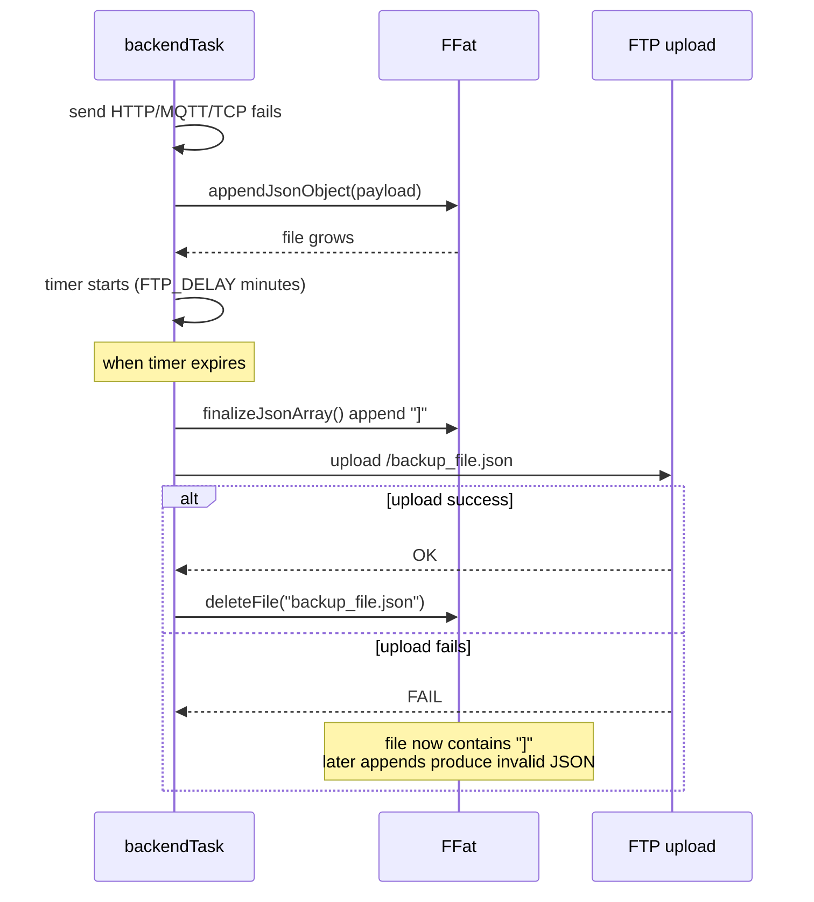
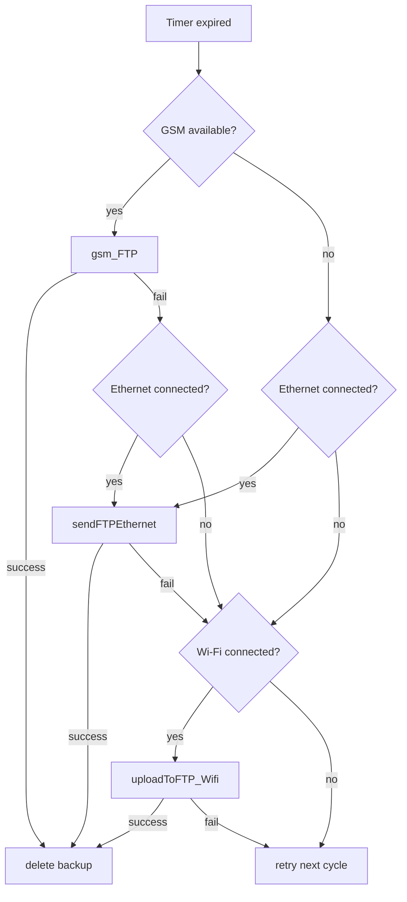

The Ethicstech IoT Gateway Lite uses the ESP32 FAT filesystem (FFat) for configuration persistence and for offline data buffering. All buffered payloads are stored in a single JSON array file that is finalized only at upload time. Uploads run over GSM (FTPS), Ethernet (plain FTP), or Wi-Fi (plain FTP) depending on which network is available.

## Backup file format

The offline queue is a JSON array stored at `/backup_file.json`.

- **First write:** `"["` + first JSON object (no closing bracket).
- **Subsequent writes:** `","` + next JSON object (still no closing bracket).
- **Upload preparation:** `finalizeJsonArray()` appends `"]"` to close the array.

This design means the file is an incomplete JSON array until the moment it is uploaded. If the device reboots or loses power after appending data but before upload, the file remains unclosed and must be repaired before any JSON parser can read it.

## When queuing happens

`appendJsonObject(payload)` (`functions.h` L951) is called by `backendTask` whenever a transport send fails or when no protocol is enabled. It applies two filters:

1. `servers.use_FTP` must be true. If FTP is disabled, `appendJsonObject` returns immediately and the payload is lost.
2. Consecutive duplicate payloads are skipped. A static `String payload_` remembers the last value; if the new payload is identical, it is discarded.

There is **no size cap**, **no free-space check**, and **no rotation** on `/backup_file.json`. The file grows unbounded until a successful upload deletes it.

## Append, read, upload, and delete flow



## FTP upload scheduling

The backend uses a per-transport wait timer (`ftpWaitActive` / `ftpStartWaitTime`) to avoid uploading on every cycle. The timer starts when `hasStoredData()` returns true and `servers.use_FTP` is enabled. After `servers.FTP_DELAY` minutes elapse, the timer stops and upload is attempted.

The filename format is:

```text
<getDeviceFolderName()>_YYYY_MM_DD_HH_MM_SS.json
```

`getDeviceFolderName()` returns `company_name` (from Preferences) if set, otherwise the MAC address without colons. The timestamp comes from `rtc1` (internal ESP32Time), not the external RTC.

### Upload priority and fallback



### Transport-specific upload functions

| Transport | Function | Effective port | Protocol | Notes |
| --- | --- | --- | --- | --- |
| GSM | `gsm_FTP()` (`sima7672s.h` L843) | 21 (hard-coded) | FTPS (TLS 1.2) | Uses AT `+CFTPS*` commands; `ftps_init_once()` configures SSL context 0 |
| Ethernet | `sendFTPEthernet()` (`functions.h` L1231) | `servers.ftp_port` | Plain FTP | Raw socket commands; data stream in 1 KB chunks |
| Wi-Fi | `uploadToFTP_Wifi()` (`functions.h` L1436) | captured at global construction time | Plain FTP | `ESP32_FTPClient`; checks `isConnected` after `NewFile` |

<Warning>
  The Wi-Fi `ESP32_FTPClient` object is constructed globally at `functions.h` L27 with `servers.ftp_port`. Because construction happens before `loadServerconfig()` runs, a non-default port configured in `/servers.json` may not take effect on Wi-Fi until the next cold boot.
</Warning>

<Warning>
  GSM FTPS hard-codes port 21 in the `AT+CFTPSLOGIN` command, so `servers.ftp_port` has no effect on the GSM path.
</Warning>

## finalizeJsonArray corruption issue

`finalizeJsonArray()` (L1164) unconditionally appends `"]"` to `/backup_file.json` at the start of every upload attempt. If the upload fails, the file retains the closing bracket. The next time data arrives, `appendJsonObject()` prepends a comma and appends another object, producing invalid JSON such as:

```json
[{"timestamp":"..."}],{"timestamp":"..."}
```

If the next upload also fails, `finalizeJsonArray()` appends another `"]"`, compounding the corruption. This is a confirmed data-integrity bug. There is no repair logic or JSON validation before upload.

## No capacity cap

The backup queue has no maximum size and no free-space check. On a device with a large `trans_delay`, a small FFat partition, and frequent send failures, the file can grow until the filesystem is full. The behavior of FFat when full is not documented in the source.

## Questions for hardware testing

The following behaviors should be verified on actual hardware:

- **FFat partition size and write endurance.** What is the effective free space after formatting? How many write cycles can the flash sustain with continuous append operations?
- **Behavior when FFat is full.** Does `appendJsonObject()` fail gracefully, or does it hang/crash? Is there a Serial error message?
- **Large-file upload time vs. watchdog.** The backend watchdog timeout is 65 seconds. How long does it take to upload a full `/backup_file.json` over Ethernet or Wi-Fi FTP? Could a large file trigger `esp_task_wdt_init` panic?
- **FTPS server compatibility.** The GSM FTPS implementation uses explicit TLS (`AUTH TLS`) with TLS 1.2, no client certificate, and `AT+CFTPSSINGLEIP=1`. Does this work with your target FTP server? Does passive mode data channel routing behave correctly behind NAT?
