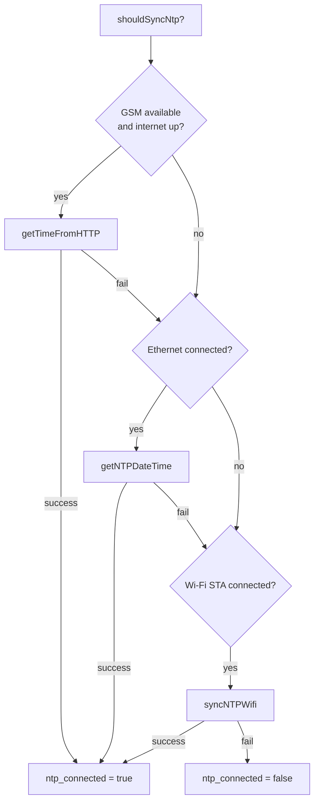

The Ethicstech IoT Gateway Lite maintains two clocks: an external MCP7940 real-time clock (RTC) over I2C and an internal ESP32Time (`rtc1`) kept by the SoC. Both are set during initialization and periodically resynchronized from one of three network time sources. The payload timestamp always comes from the external RTC, while FTP filenames use the internal clock.

## Clock initialization

During `backendTask` startup (`lite_V_0_6_ffat__hybrid.ino` L397):

1. `initRTC()` (`functions.h` L1354) calls `MCP7940.begin()`. Failure is logged but not fatal.
2. `startRTC()` (L1364) checks the oscillator status and starts it if necessary.
3. `rtcBattery()` (L1380) enables battery backup so the clock persists across power loss.

If the MCP7940 is absent or the battery is dead, these calls fail silently and the external RTC holds an undefined date. The firmware still reads from it for every payload (see `Requires hardware verification` below).

## Internal clock

`ESP32Time rtc1` (global in `lite_V_0_6_ffat__hybrid.ino` L13) is never explicitly set to a known value at boot. It is updated after each successful NTP or HTTP time sync (`rtc.setTime(...)` in `syncNTPWifi()` and `getTimeFromHTTP()`). `rtc2` (in `functions.h` L26) is also set during Wi-Fi NTP sync but is not referenced elsewhere in the current code.

## Time sync sources and priority

The backend attempts time synchronization in a fixed priority order. The interval depends on whether the clock has ever been set successfully.

| State | Interval | Behavior |
| --- | --- | --- |
| `!ntp_connected` | Every 30 seconds | Retry continuously until a source succeeds |
| `ntp_connected` | `servers.ntpsynctimeinterval` minutes (default 30) | Periodic resync |



### GSM HTTP time (`getTimeFromHTTP`)

- **Source:** Hard-coded vendor HTTP endpoint (`sima7672s.h` L650).
- **Method:** `AT+HTTPACTION=0` GET request; parses JSON response for `year`, `month`, `date`, `hour`, `minute`, `second`.
- **Offset:** Adds 7 seconds as a fudge factor to account for modem latency (L680).
- **Sets:** `rtc.setTime(...)` and `adjustRTCTime(...)` (MCP7940).

<Info>
  `checkInternet("google.com")` only verifies that the modem HTTP stack initializes successfully; it does not guarantee end-to-end reachability of the actual time server.
</Info>

### Ethernet NTP (`getNTPDateTime`)

- **Source:** `servers.ntpServerName` (default hard-coded IP).
- **Method:** UDP local port 2390, up to 3 attempts with 1.5 second waits (`functions.h` L1270).
- **Offset:** `timeZoneOffset = 19800` seconds (+05:30 IST) is applied immediately after NTP epoch conversion (`functions.h` L1305).
- **Validation:** Rejects packets with epoch before 2020-01-01.
- **Sets:** `adjustRTCTime(...)` (MCP7940) and `rtc.setTime(...)`.

### Wi-Fi NTP (`syncNTPWifi`)

- **Source:** `servers.ntpServerName`.
- **Method:** `configTime(timeZoneOffset, daylightOffset_sec, servers.ntpServerName)` (L1412), 5 second max wait for SNTP sync completion.
- **Offset:** Same +05:30 offset (`timeZoneOffset = 19800`, `daylightOffset_sec = 0`).
- **Sets:** `adjustRTCTime(...)` (MCP7940) and `rtc2.setTime(...)`.

## Hard-coded +05:30 offset

Both NTP paths add `timeZoneOffset = 19800` seconds (+05:30) to the UTC epoch. The payload timestamp is then formatted with a literal `+05:30` suffix:

```cpp
sprintf(inputBuffer, "%04d-%02d-%02dT%02d:%02d:%02d+05:30",
        now.year(), now.month(), now.day(),
        now.hour(), now.minute(), now.second());
```

This is true regardless of which time source provided the original sync. There is no timezone configuration in the UI or settings.

## Which clock feeds what

| Output | Clock source | Notes |
| --- | --- | --- |
| Payload `timestamp` | `MCP7940.now()` | Formatted with `+05:30`; always external RTC |
| FTP filename timestamp | `rtc1.getTime("_%Y_%m_%d_%H_%M_%S")` | Internal ESP32Time |
| MQTT client ID (GSM/Wi-Fi) | `getDeviceFolderName()` | derived from `company_name` or MAC |

If the MCP7940 is absent or loses power, `MCP7940.now()` returns an undefined DateTime. The payload will still be transmitted with a timestamp, but the value is meaningless until the clock is set. The firmware does not skip transmission when `ntp_connected` is false.

## Behavior when sources are unavailable

- If no time source succeeds, `ntp_connected` remains false and resync retries every 30 seconds.
- Payloads are still built and sent with whatever value `MCP7940.now()` holds.
- Ethernet and Wi-Fi FTP uploads are **blocked** when `!ntp_connected` because the filename generation logic checks `ntp_connected && servers.use_FTP`.
- GSM FTP uploads are **not blocked** by `ntp_connected`; they proceed even without a valid time (filename uses `rtc1`, which may be uninitialized).

## Paths needing hardware verification

The following should be confirmed on actual hardware:

- **MCP7940 presence and battery.** Does `initRTC()` succeed? Does the oscillator keep running with the coin cell fitted? Is the battery voltage within spec for backup operation?
- **I2C bus integrity.** `MCP7940.begin()` relies on `Wire.begin()` with default SDA/SCL pins. Are the pull-ups adequate for the chosen ESP32 module?
- **Modem HTTP time endpoint.** The hard-coded IP in `getTimeFromHTTP()` may be unreachable from your network or may return a different JSON shape. Does `getTimeFromHTTP()` return true on first boot?
- **NTP server reachability.** The default NTP server is a hard-coded IP in `servers.ntpServerName`. Is it reachable over Ethernet and Wi-Fi? Does it respond to UDP port 123?
- **RTC drift across temperature.** How much does the MCP7940 drift between NTP resync intervals? The default resync interval is 30 minutes.

## Time-related globals

| Global | Type | Purpose |
| --- | --- | --- |
| `ntp_connected` | bool | True after any time source succeeds |
| `external_rtc_connected` | bool | True after `initRTC()` + `startRTC()` + `rtcBattery()` succeed |
| `timeZoneOffset` | const long (19800) | IST offset in seconds |
| `daylightOffset_sec` | const int (0) | No daylight saving support |
| `servers.ntpsynctimeinterval` | uint32_t | Minutes between resyncs when already synced |
